<p>
<picture>
  <source media="(prefers-color-scheme: dark)" srcset="assets/hero-dark.svg">
  
</picture>
</p>

<p align="center">
  <a href="#install"></a>
  
  
  
  
</p>

<p align="center">
  <a href="#install">Install</a> ·
  <a href="#in-claude-code">In Claude Code</a> ·
  <a href="#hand-over-a-task">Hand over a task</a> ·
  <a href="#how-it-works">How it works</a> ·
  <a href="#measured-not-claimed">Measured</a> ·
  <a href="#commands">Commands</a> ·
  <a href="#more">Docs</a>
</p>

Your best model shouldn't spend its turns reading files and typing out boilerplate. **dsk** is a small headless CLI that Claude Code calls through Bash to hand that work to DeepSeek V4.1 Flash: Claude plans, reviews and decides; the worker scouts the code and writes it, tests, docs and web research included. Written in TypeScript and run by Node with no dependencies, the worker's scripts in Python, shipped as a Claude Code plugin: the skill, a reviewer agent, the review gate and a display of the jobs.

- **About 3 turns, not 30.** Each turn the worker sends one Python script that reads, edits, runs and searches through a small function API, and only what it prints comes back.
- **Nothing lands unreviewed.** `dsk` runs every `--check` itself, undoes what a script changed outside `--allow`, and a Stop hook sends Claude back to any session still waiting for `accept` or `reject`.
- **Measured, not claimed.** In a report only `summary`, `answer`, `notes` and `question` are the worker's words. Every other line is measured by `dsk`.
- **Cheap to keep going.** Every request extends the one before it byte for byte, so most of the input is a cache hit, and a run that loses its provider continues on the next one.

## Install

In Claude Code, straight from this repository. It is its own marketplace, so nothing has to be published or added first:

```
/plugin install dsk --marketplace asx8678/dsk
```

Claude Code then asks which provider runs the worker, and for what that provider needs:

| Provider | What you enter |
|---|---|
| `official` | your DeepSeek API key |
| `custom` | the endpoint URL of any OpenAI-compatible API that serves a DeepSeek model, the model name, and that endpoint's API key. Every main task runs on that endpoint. A DeepSeek API key is optional here and serves web search only: with one, web search (`--web`, `dsk search`, `dsk fetch`) is available. Without one, those answer `web search needs the key DEEPSEEK_API_KEY and there is none`, and say how to add it |

- **Keys** are masked as you type and kept in Claude Code's secure store.
- **To change an answer,** `/plugin configure dsk@asx8678` opens the same form again; restart Claude Code after changing it. Everything else is changed in `/dsk config`: see [In Claude Code](#in-claude-code).
- **To update,** type `/dsk update`: see [In Claude Code](#in-claude-code).
- **To check it,** `dsk doctor` tests the key and the model against the provider, and `dsk configure` shows how dsk is set up. Until a provider is set, each session starts by saying what is missing.
- **It needs** Node.js 22.18 or newer on `PATH`, which runs dsk, and Python 3.13 or newer, as `python3` or as `python3.13`, `python3.14` or `python3.15`, which runs the worker's scripts. When one is missing, the session says so at its start.

<details>
<summary>From a shell, or to work on dsk itself</summary>

`claude plugin install dsk --marketplace asx8678/dsk` installs without asking, and each `--config KEY=VALUE` sets one option (`provider`, `deepseek_api_key`, `custom_base_url`, `custom_model`, `custom_api_key`).

```
./install.sh              # installs dsk from GitHub as dsk@asx8678, or updates it when it is installed
./install.sh --local      # the same with the dsk in this checkout; Claude Code loads it from there
./install.sh --dev        # links this checkout as dsk@skills-dir instead, so edits take effect at once
./install.sh --uninstall  # uninstalls dsk from Claude Code; ~/.config/dsk and ~/.local/state/dsk stay
```

Keys in `~/.config/dsk/env` and profiles in `~/.config/dsk/config.json` work too, and win over the form. [docs/configuration.md](docs/configuration.md) says what each `install.sh` mode does and how to set dsk up by hand, with more than one provider.

</details>

## In Claude Code

One command, typed like any other slash command, with a word after it for all but the list:

| You type | What it does |
|---|---|
| `/dsk` | Opens the list of jobs: this session's jobs from the last day (running, waiting for you, finished) with their cost, and what runs in other sessions. `[ diff ]` and `[ turns ]` on a job open its whole diff or each of its turns |
| `/dsk enable` | Turns delegation and the job display on: Claude hands work to dsk, running jobs show above the prompt, and `/dsk` lists them. It stays on in every session you start afterwards |
| `/dsk disable` | Turns both off: Claude does the work itself, and new dsk runs are refused. A `dsk run`, `answer` or `continue` from Claude, and a `reject` that sends defects back, are not run; jobs that are running finish, and `dsk show`, `accept` and `reject --drop` still work on the jobs there are. Nothing is shown. It stays off in every session you start afterwards, until `/dsk enable` |
| `/dsk update` | Fetches the newest dsk from this repository and installs it, then says which version you had and which you have now. Restart Claude Code, or run `/reload-plugins`, to load it |
| `/dsk config` | Opens the settings pane: dsk's version, delegation and the display on or off, and the providers. Everything under [Providers and models](#providers-and-models) is done here |

- **`/dsk enable` and `/dsk disable` take the place of `/dsk on` and `/dsk off`** (0.10.4), which are gone. They also do more: the old words turned only the display on and off, and Claude went on delegating either way. A `/dsk off` typed before 0.10.4 therefore leaves delegation on. To have the one without the other, `/dsk config` has a row for each: `Delegation` and `Job display`.
- **As you type `/dsk`,** the suggestions list `/dsk enable`, `/dsk disable`, `/dsk update` and `/dsk config` beneath `/dsk`, and a word begun after `/dsk ` is completed (`/dsk u` offers `update`).
- **The version** is shown at the top of `/dsk config`, by `/dsk update`, in the first line of `dsk configure`, and once at the start of the first session after an install or an update (`dsk 0.9.1 → 0.10.0 updated.`).
- **`/dsk update` by hand** is these two commands, which also work from a shell; your keys and `~/.config/dsk` stay:

  ```
  claude plugin marketplace update asx8678
  claude plugin update dsk@asx8678
  ```

  `./install.sh` in a checkout updates dsk too when it is already installed. An update is only found when the `version` in `skill/.claude-plugin/plugin.json` went up.

### Providers and models

A provider is an API that serves a DeepSeek model: DeepSeek's own (`official`), or any OpenAI-compatible endpoint you add (a custom provider). `/dsk config` lists them in the order a run tries them, each with its model, its endpoint and whether its key is set. It looks roughly like this:

```
dsk 0.13.1 · settings
  Delegation   ● on  Claude hands the hands-on work to dsk
  Job display  ● on  running jobs show above the prompt, /dsk lists them
  Route order  your priority  providers are tried as numbered below

Providers
The first that answers does the work; the next takes over when one fails.
  1: myhost    deepseek-v4.1-flash · example.com/v1
  2: official  deepseek-flash · api.deepseek.com
  ○  spare     disabled · deepseek-v4.1-flash · spare.example.com/v1
  +  Add a provider

Enter to select · ↑/↓ to move · 1–2 to open a provider · Esc to close
```

Every row is one control: ↑ and ↓ (or Tab) move between rows, Enter presses the one that is lit, and a provider's number opens it. A provider opens into its own view, with its model, endpoint, key and place on the route, and what can be done with it:

```
myhost
● on the route, tried 1st of 2

  Model    deepseek-v4.1-flash
  API URL  https://example.com/v1
  API key  set, in DSK_MYHOST_API_KEY
  Route    myhost → official

  f: Try first  it is first
  u: Move up  it is first
  d: Move down
  e: Edit name, URL, model or key
  x: Disable
  b: Back to the list
```

Esc goes back to the list, and from the list closes the pane. In a pane too short to show all of a view, the arrows scroll it and Tab moves between rows; the line of keys at the bottom says which holds. Claude Code keeps the left and right arrows for the prompt, so nothing in the pane uses them.

**Who does what.** Web search and the work are set apart:

| What you have | Who does the work (scouting, writing code, reviews) | Web search (`--web`, `dsk search`, `dsk fetch`) |
|---|---|---|
| Official DeepSeek only | official | official |
| Official DeepSeek and a custom provider | the custom provider first. Official is the fallback when the custom one fails, or does no work at all if you set it to **web search only** | official |
| A custom provider only, no DeepSeek key | the custom provider | not available: it needs a DeepSeek API key |

- **Official DeepSeek always serves web search** once its key is entered, whatever else is set up. Web search has no other provider.
- **A custom provider is tried first.** One you add with `+ Add a provider` goes ahead of official DeepSeek on the route (and after the custom providers you already have); so does one you enable again. Picking `custom` in the install form goes further: every task runs on the custom endpoint, and official DeepSeek is left with web search only.
- **Official DeepSeek: web search only, or work as well.** Its view has one action for it. `Use for web search only` takes it off the route: no task is ever sent to it, and its row says `web search only`. `Use for work as well` puts it back, as the last provider tried. dsk refuses web search only while official is the only provider that can do the work.
- **Priority.** With more than one provider enabled, a provider's view has `Try first`, `Move up` and `Move down`: the number on its row is its place, `1` is tried first, `2` takes over when it fails, and so on. The view stays open after a move, so pressing again moves it further.
- **Your priority, or the fastest first.** `Route order` in the list chooses what decides who is tried first: `your priority`, the numbers, or `fastest first`, the speed test (`"route_order": "fastest"`). Giving a provider a place is a choice of priority, so it sets the order back to `your priority`; pressing `Route order` brings the fastest first back.
- **The model.** `Edit` on a provider opens its name, API URL, model name and API key. Change **Model name** to the model id as that endpoint lists it and save. `official` starts as `deepseek-flash`; a custom provider uses whatever you entered. An empty API key field keeps the key you have. `dsk doctor` then tests the key and the model against the provider.
- **Add, rename, disable, delete.** `+ Add a provider` asks for a name, API URL, model name and API key. A rename keeps the key and the place on the route, and running jobs carry on; a name another provider has is refused. `Disable` takes a custom provider off the route without deleting it; `Enable` puts it back. `Delete` asks first, then removes the provider and its API key from `~/.config/dsk/env`, unless another provider or web search uses that key or you named the key yourself (dsk names them `DSK_<NAME>_API_KEY`). It is refused while a running job uses the provider or could fail over to it; a stopped job that ran there takes `--profile` to go on. Official DeepSeek and the install form's `custom` would come back, so they can only be disabled.
- **Where it is kept.** The pane writes `~/.config/dsk/config.json` (every other setting in it is kept) and puts keys in `~/.config/dsk/env`, readable by you alone. Both win over the install form.

The same from a shell:

```sh
dsk provider list                                  # the route in order, and who serves web search
echo "$KEY" | dsk provider add myhost --url https://example.com/v1 --model deepseek-v4.1-flash --key-stdin
dsk provider set official --model deepseek-flash   # change a model; --url and --key-stdin change the rest
dsk provider move myhost 1                         # priority: tried first
dsk provider order fastest                         # the speed test decides who is tried first; `listed` is your priority
dsk provider disable official                      # official DeepSeek: web search only
dsk provider enable official                       # official DeepSeek: web search and work, tried last
dsk provider rename myhost fast
dsk provider remove fast                           # and its key, unless another provider or web search uses it
```

With `"route_order": "fastest"` in `config.json`, which `dsk provider order fastest` and `Route order` in the pane write, the provider measured fastest is tried first, whatever the priority says; `/dsk config` and `dsk provider list` say so when it is set. A `dsk provider move` or `up` after that sets it back to `listed`: a place you choose counts. See [docs/configuration.md](docs/configuration.md#providers).

## Hand over a task

Claude does this for you through the skill. By hand it is one command: a brief, the paths the worker may change, and a check that `dsk` runs itself.

```sh
dsk run --allow 'test_*.py' --check 'python3 -m unittest' "Add unit tests for durations.py"
```

<p>
<picture>
  <source media="(prefers-color-scheme: dark)" srcset="assets/run-dark.svg">
  
</picture>
</p>

That's a real run against a 24-line module: 4 turns, 70 lines of tests, and the check run by `dsk` itself. The fastest provider was full, so the run started on the next one in the route. A report names an earlier provider, as in `thirdparty after coralbricks`, only when the run left it after sending it a request. A `cache:` line appears when the provider missed its cache on more than a fifth of the input it had been sent already, which in 119 logged sessions never happened to a provider that caches. Once the diff is read, `dsk accept` marks the work as reviewed.

Every command prints a short plain-text report on stdout. `--verbose` adds one line per turn on stderr. The last line of a report names the commands that are valid next.

| Status | Meaning | Exit code |
|---|---|---|
| `review` | files changed, or written at a path git ignores; checks passed, waiting for accept or reject | 0 |
| `done` | no file changed and none written at a path git ignores: a read-only answer, or a writable run that found nothing to change; the answer is in the report | 0 |
| `question` | the worker called `ask()` | 2 |
| `stuck` | same reply three times, three replies in a row that showed nothing new, or three failing turns in a row | 3 |
| `limit` | turn, time or token limit reached | 3 |
| `error` | API, config or internal error, or an interrupted run | 1 |

<p>
<picture>
  <source media="(prefers-color-scheme: dark)" srcset="assets/states-dark.svg">
  
</picture>
</p>

A stop is not the end of a session. `answer` and `reject ID "defects"` send it back to work, and `continue` gives it the next task; each time the worker keeps its context.

`summary`, `answer`, `notes` and `question` are the worker's claims. Every other line is measured by `dsk`.

A `caution:` line names a check the worker ran itself, and saw pass, before it changed anything: such a check cannot show that the task was done. In one batch of 48 runs that fixed visual defects, the check had passed beforehand in 43. The line appears only when the worker happened to run the check first, so its absence says nothing.

Every flag, an example report as text and the report as JSON (`--json`): [docs/commands.md](docs/commands.md).

## How it works

<p>
<picture>
  <source media="(prefers-color-scheme: dark)" srcset="assets/flow-dark.svg">
  
</picture>
</p>

**One script per turn.** Every request carries one static tool, `run_code(code)`, and with thinking off the call is forced. Inside the script: `read`, `write`, `edit`, `glob`, `grep`, `sh`, `search`, `fetch`, `note`, `ask`, `done`. Each script runs in a fresh `python3 -I` child with a hard timeout that kills its process group.

**A ledger, not a transcript.** The child reports every API call to the parent over a socket. Reports and compaction are built from that ledger, not from what the model says.

**A cache prefix that never moves.** The system prompt and the tool are constants in the source, and the first user message is ordered stable-first: `DSK.md`, run header, attached files, brief. A session is an append-only JSONL log, and before each send `dsk` checks that the serialized messages extend the previous request of the series byte for byte. Compaction makes no model call, so the same log always compacts to the same bytes.

**Gates.** The working tree is recorded as a tree object at start, around every script and check, and at every stop, so only what changes while a script or a check is running is attributed to the worker. What a script changed outside `--allow` is undone by `dsk`, and a copy is kept. `dsk` runs each `--check` itself: a failure goes back to the worker and the run continues. The Stop hook exits 2 while a session started by the current Claude Code session is in `review`.

<p>
<picture>
  <source media="(prefers-color-scheme: dark)" srcset="assets/gates-dark.svg">
  
</picture>
</p>

The picture's second row is an example of what the scope gate is for: a formatter started with `sh()` rewrites a file outside `--allow`, and `dsk` puts the file back and keeps a copy of the change.

**Worktrees.** `--worktree` runs the task in a fresh git worktree seeded with your uncommitted state. `accept` applies the worktree as it stands to the main tree with `git apply`: changes land uncommitted, and a conflict is refused as a whole. A worktree hands in only what git tracks or would track, so `dsk run --worktree`, and `dsk continue` of a worktree session, refuse an `--allow` pattern that names a path git ignores: `accept` applies only what git tracks, and the worktree is then deleted.

**Providers.** A session starts on the first profile in `route`, or with `"route_order": "fastest"` on the fastest one that has a free slot. On 402, or when retries of a network failure, 408, 429 or any 5xx are used up, it continues on the next profile in a new series, and so does a worker that keeps sending the same reply. A profile that reports its credit used up is paused: runs skip it until the pause ends, unless it is the last one in the route.

<p>
<picture>
  <source media="(prefers-color-scheme: dark)" srcset="assets/route-dark.svg">
  
</picture>
</p>

The run in the picture is an example. The real run further up took the first step of it: `coralbricks` had no free slot, so the run started on `thirdparty`.

The protocol in full is in [docs/internals.md](docs/internals.md); routing, failover, slots and pauses are in [docs/configuration.md](docs/configuration.md#providers).

## Measured, not claimed

<p>
<picture>
  <source media="(prefers-color-scheme: dark)" srcset="assets/stats-dark.svg">
  
</picture>
</p>

The figures on this page were measured. Three turns is the median task on the bench, and 85 to 92% is the share of a code task's input that came from the cache from turn 3 on, on the official API. [docs/build-notes.md](docs/build-notes.md) has how each was measured, and what fell short of its target.

The cache carries that much because every request extends the one before it byte for byte: the provider reads the old part from its cache, and only what the last turn appended is new. The chart is one real session, on a third-party gateway and with its cold first turn counted: 76% of its input came from the cache, and 82% from turn 3 on.

<p>
<picture>
  <source media="(prefers-color-scheme: dark)" srcset="assets/cache-dark.svg">
  
</picture>
</p>

It is the session that wrote the first generator of this page's images: 7 turns and 55,961 input tokens, 42,752 of them read from the cache. Turn 1 starts cold, and turn 7 carries the long script that turn 6 wrote. A tick between two bars marks where the upper one's request ended, and the cached part of the bar below stops just short of it: that is the previous request, read again.

<details>
<summary>The numbers behind the chart</summary>

| Turn | Input tokens | Read from the cache | New | Cached share |
|---|---|---|---|---|
| 1 | 5,798 | 1,024 | 4,774 | 18% |
| 2 | 6,297 | 5,632 | 665 | 89% |
| 3 | 6,545 | 6,144 | 401 | 94% |
| 4 | 6,716 | 6,400 | 316 | 95% |
| 5 | 8,216 | 6,656 | 1,560 | 81% |
| 6 | 8,957 | 8,192 | 765 | 91% |
| 7 | 13,432 | 8,704 | 4,728 | 65% |
| all | 55,961 | 42,752 | 13,209 | 76% |

`dsk show ID --log` prints these columns for any session.

</details>

## The plugin

`skill/` is the plugin, in Claude Code's standard layout, and `.claude-plugin/marketplace.json` at the root of this repository is what lets `/plugin install` find it:

| Part | File | What it is |
|---|---|---|
| Manifest | `.claude-plugin/plugin.json` | the name, the version, and `userConfig`: the five options of the form above |
| Skill | `SKILL.md` | tells Claude when and how to delegate; Claude loads it by itself. By hand it is `/dsk:delegate`: the skill is not named `dsk`, because `/dsk` is the command |
| Agent | `agents/reviewer.md` | `dsk:reviewer`, for a careful change whose review packet is too long to read inline |
| Command | `bin/dsk` | on the `PATH` of Claude's Bash tool while the plugin is enabled |
| Hooks | `hooks/hooks.json` | three commands: at session start and before each prompt, `dsk configure --hook`; at each stop, `dsk status --hook` |
| Hooks module | `hooks/register.tsx` | the display and the command `/dsk`; TypeScript, because Claude Code runs it itself |
| CLI | `scripts/dsk.ts`, `scripts/lib/` | everything else, in TypeScript. `scripts/start.mjs` runs the build in `scripts/dist/` while it matches the sources, else the sources; `scripts/runner.py` runs the worker's scripts. Claude Code never loads it, it only runs it |

The Stop hook and the two configure hooks are always on. Delegation and the display are switches: `/dsk enable` turns both on and `/dsk disable` turns both off, in the session where you type it and in the sessions you start afterwards, and `Delegation` and `Job display` in `/dsk config` turn each by itself. An install that never chose hands work to dsk with the display off. Off, Claude is told to do the work itself (in its prompt, in the skill, and in the refusal of a `dsk run`), and the display reads nothing and draws nothing; a `dsk` you run yourself in a shell is not refused. `/dsk` lists the jobs. Every command is in [In Claude Code](#in-claude-code).

What the display draws, and how the form's answers reach `dsk`: [docs/plugin.md](docs/plugin.md).

## For agents

The skill tells Claude when to delegate, how to brief and how to review. To make dsk the default for hands-on work, put this in `CLAUDE.md`:

```md
Use the `dsk` skill for the hands-on work: scouting the code and writing it. You plan, review and decide.
Review every diff before `dsk accept`.
```

A `DSK.md` at a repository's root opens every run's first message: the layout, how to run the checks, the conventions. Keep it short and stable, so it stays a cached prefix.

## Guardrails, stated honestly

The AST gate, the audit hook behind it (which refuses a script that opens a file for writing or starts a process outside `write()`, `edit()` and `sh()`), the scrubbed environment, the denylist and the scope gate stop an obedient but mistaken model. On macOS, scripts, `sh()` and checks also run under `sandbox-exec`: writing outside the working directory, the session's scratch folder, the temp folders and the usual build caches fails, and so does writing in `.git`, whose hooks and config would run code outside the sandbox. dsk's key file, the plugin's `options.json` (where its form keeps the keys) and the `.new` copy written beside it, `~/.ssh`, `~/.aws` and other credential stores cannot be read. It does not cover the network or git-ignored files inside the tree, and on Linux there is none: there a worker with `sh()` is as powerful as a shell and can read any file you can. Keep `--web` off for tasks that also need `sh()` in a repository with secrets, because fetched pages are untrusted input. Nothing here prevents running `dsk` inside a container.

An in-place run cannot tell its own script's side effects from an edit someone else makes during the same seconds. Such an edit outside `--allow` is undone with the script's (a copy is kept). Use `--worktree` when anyone else is working in the tree.

What is known not to work yet: [docs/limits.md](docs/limits.md).

## Commands

| | |
| --- | --- |
| `run "brief"` | a task: `--allow GLOB`, `--check CMD`, `--file PATH[:A-B]`, `--web`, `--worktree`, `--effort`, `--profile`, `--max-turns`, `--recheck`, `--reviewer`, `--json` |
| `answer ID "text"` | reply to the worker's question; the run continues |
| `show ID` | the report again: `--review`, `--diff`, `--log`, `--answer`, `--json` |
| `accept ID` | mark as reviewed; after `--worktree`, apply the changes to the main tree |
| `reject ID "defects"`, `reject ID --drop` | send defects back into the same session (`--max-turns` for that round); discard the work |
| `continue ID "task"` | the next task into a session that is done or accepted; the worker keeps its context |
| `status`, `wait [ID ...]` | this project's open sessions; block until sessions have stopped |
| `stats [ID ...]` | what sessions measured: outcomes, where the turns went, tokens, time, per profile |
| `search "query"`, `fetch URL` | raw web search and page fetch, no model |
| `doctor`, `bench`, `configure` | check each profile; time each provider, fastest first; how dsk is set up, with its version |
| `provider list\|add\|set\|rename\|move\|up\|order\|enable\|disable` | what `/dsk config` runs: the providers, their models and keys, their priority, whether the priority or the speed test decides who is tried first, and whether official DeepSeek does work or web search only |

## Tests

```
npm run check                             # TypeScript 7 type-checks the sources; every async call is awaited
npm run build                             # compiles them into skill/scripts/dist/, which start.mjs runs while it is fresh
bun run prove                             # gdp-wired proves the laws of the stop rules, the scope gate, the lifecycle and retries
python3 -m unittest discover -s tests     # 128 tests against a scripted API server and temp git repositories
python3 tests/live.py --table             # real toy tasks on the real providers; costs a few cents
sh tests/install_test.sh                  # install.sh against a throwaway home folder, without the network
```

`../trials` holds a harness that plays the lead on realistic small projects and grades the result with held-out tests and mutants, the session logs it collected, and `FINDINGS.md`.

## More

- [docs/commands.md](docs/commands.md): every command and flag, a report as text, the report as JSON.
- [docs/internals.md](docs/internals.md): the protocol in full: the reply format, the function API, execution, the cache, compaction, the gates, worktrees, state, stats and progress.
- [docs/configuration.md](docs/configuration.md): `install.sh`, keys, `config.json`, more than one provider, routing, failover, slots and pauses.
- [docs/plugin.md](docs/plugin.md): how the form's answers reach `dsk`, and what the display draws.
- [docs/build-notes.md](docs/build-notes.md): what differs from the build prompt, and what was measured on the way.
- [docs/limits.md](docs/limits.md): known limits, and what is left for later.
- [assets/build.py](assets/build.py): writes this page's images, in a light and a dark theme, and [assets/check.py](assets/check.py) measures them: a text that leaves its card, two that overlap, a line through one. From a checkout, open `assets/preview.html` in a browser to see them all move, on both backgrounds.
