<p>
<picture>
  <source media="(prefers-color-scheme: dark)" srcset="assets/hero-dark.svg">
  
</picture>
</p>

<p align="center">
  <a href="#install"></a>
  
  
</p>

Your best model shouldn't spend its turns reading files and typing out boilerplate. **dsk** is a small headless CLI that Claude Code calls through Bash to hand that work to DeepSeek V4.1 Flash: Claude plans, reviews and decides; the worker scouts the code and writes it, tests, docs and web research included. One Python file, standard library only, shipped as a Claude Code plugin: the skill, a reviewer agent, the review gate and a display of the jobs.

- **About 3 turns, not 30.** Each turn the worker sends one Python script that reads, edits, runs and searches through a small function API, and only what it prints comes back.
- **Nothing lands unreviewed.** `dsk` runs every `--check` itself, undoes what a script changed outside `--allow`, and a Stop hook sends Claude back to any session still waiting for `accept` or `reject`.
- **Measured, not claimed.** In a report only `summary`, `answer`, `notes` and `question` are the worker's words. Every other line is measured by `dsk`.
- **Cheap to keep going.** Every request extends the one before it byte for byte, so most of the input is a cache hit, and a run that loses its provider continues on the next one.

## Install

In Claude Code:

```
/plugin install dsk --marketplace asx8678/dsk
```

Claude Code then asks which provider runs the worker, and for what that provider needs:

| Provider | What you enter |
|---|---|
| `official` | your DeepSeek API key |
| `custom` | the endpoint URL of any OpenAI-compatible API that serves a DeepSeek model, the model name, and that endpoint's API key. A DeepSeek API key is optional here: with one, the official API is the fallback and web search (`--web`) is available |

Keys are masked as you type and kept in Claude Code's secure store. `/plugin configure dsk@asx8678` opens the same form again; restart Claude Code after changing it. From a shell, `claude plugin install dsk --marketplace asx8678/dsk` installs without asking, and each `--config KEY=VALUE` sets one option (`provider`, `deepseek_api_key`, `custom_base_url`, `custom_model`, `custom_api_key`). Until a provider is set, each session starts by saying what is missing, and `dsk configure` shows how dsk is set up. `dsk doctor` checks the key and the model against the provider.

The plugin needs Python 3.13 or newer on `PATH`, as `python3` or as `python3.13`, `python3.14` or `python3.15`.

From a shell, or to work on dsk itself:

```
./install.sh              # installs dsk from GitHub as dsk@asx8678, or updates it when it is installed
./install.sh --local      # the same with the dsk in this checkout; Claude Code loads it from there
./install.sh --dev        # links this checkout as dsk@skills-dir instead, so edits take effect at once
./install.sh --uninstall  # uninstalls dsk from Claude Code; ~/.config/dsk and ~/.local/state/dsk stay
```

Keys in `~/.config/dsk/env` and profiles in `~/.config/dsk/config.json` work too, and win over the form. [docs/configuration.md](docs/configuration.md) says what each `install.sh` mode does and how to set dsk up by hand, with more than one provider.

## Hand over a task

Claude does this for you through the skill. By hand it is one command: a brief, the paths the worker may change, and a check that `dsk` runs itself.

```sh
dsk run --allow 'test_*.py' --check 'python3 -m unittest' "Add unit tests for durations.py"
```

<p>
<picture>
  <source media="(prefers-color-scheme: dark)" srcset="assets/run-dark.svg">
  
</picture>
</p>

That's a real run against a 24-line module: 4 turns, 70 lines of tests, and the check run by `dsk` itself. The fastest provider was full, so the run moved to the next one in the route (`thirdparty after coralbricks`). A `cache:` line appears when less than 80% of the input after turn 3 came from the cache; here that is turn 4 alone, and what misses is what turn 3 appended.

Every command prints a short plain-text report on stdout. `--verbose` adds one line per turn on stderr. The last line of a report names the commands that are valid next.

| Status | Meaning | Exit code |
|---|---|---|
| `review` | files changed, checks passed, waiting for accept or reject | 0 |
| `done` | no file changed: a read-only answer, or a writable run that found nothing to change; the answer is in the report | 0 |
| `question` | the worker called `ask()` | 2 |
| `stuck` | same reply three times, three replies in a row that showed nothing new, or three failing turns in a row | 3 |
| `limit` | turn, time or token limit reached | 3 |
| `error` | API, config or internal error, or an interrupted run | 1 |

`summary`, `answer`, `notes` and `question` are the worker's claims. Every other line is measured by `dsk`.

A `caution:` line names a check the worker ran itself, and saw pass, before it changed anything: such a check cannot show that the task was done. In one batch of 48 runs that fixed visual defects, the check had passed beforehand in 43. The line appears only when the worker happened to run the check first, so its absence says nothing.

Every flag, an example report as text and the report as JSON (`--json`): [docs/commands.md](docs/commands.md).

## How it works

<p>
<picture>
  <source media="(prefers-color-scheme: dark)" srcset="assets/flow-dark.svg">
  
</picture>
</p>

**One script per turn.** Every request carries one static tool, `run_code(code)`, and with thinking off the call is forced. Inside the script: `read`, `write`, `edit`, `glob`, `grep`, `sh`, `search`, `fetch`, `note`, `ask`, `done`. Each script runs in a fresh `python3 -I` child with a hard timeout that kills its process group.

**A ledger, not a transcript.** The child reports every API call to the parent over a socket. Reports and compaction are built from that ledger, not from what the model says.

**A cache prefix that never moves.** The system prompt and the tool are constants in the source, and the first user message is ordered stable-first: `DSK.md`, run header, attached files, brief. A session is an append-only JSONL log, and before each send `dsk` checks that the serialized messages extend the previous request of the series byte for byte. Compaction makes no model call, so the same log always compacts to the same bytes.

**Gates.** The working tree is recorded as a tree object at start, around every script and check, and at every stop, so only what changes while a script or a check is running is attributed to the worker. What a script changed outside `--allow` is undone by `dsk`, and a copy is kept. `dsk` runs each `--check` itself: a failure goes back to the worker and the run continues. The Stop hook exits 2 while a session started by the current Claude Code session is in `review`.

**Worktrees.** `--worktree` runs the task in a fresh git worktree seeded with your uncommitted state. `accept` applies the worktree as it stands to the main tree with `git apply`: changes land uncommitted, and a conflict is refused as a whole.

**Providers.** A session starts on the first profile in `route`, or with `"route_order": "fastest"` on the fastest one that has a free slot. On 402, or when retries of a network failure, 408, 429 or any 5xx are used up, it continues on the next profile in a new series, and so does a worker that keeps sending the same reply. A profile that reports its credit used up is paused: runs skip it until the pause ends, unless it is the last one in the route.

The protocol in full is in [docs/internals.md](docs/internals.md); routing, failover, slots and pauses are in [docs/configuration.md](docs/configuration.md#providers).

## The plugin

`skill/` is the plugin, in Claude Code's standard layout, and `.claude-plugin/marketplace.json` at the root of this repository is what lets `/plugin install` find it:

| Part | File | What it is |
|---|---|---|
| Manifest | `.claude-plugin/plugin.json` | the name, the version, and `userConfig`: the five options of the form above |
| Skill | `SKILL.md` | tells Claude when and how to delegate. `/dsk` from a checkout, `/dsk:dsk` installed from the marketplace |
| Agent | `agents/reviewer.md` | `dsk:reviewer`, for review packets too long to read inline |
| Command | `bin/dsk` | on the `PATH` of Claude's Bash tool while the plugin is enabled |
| Hooks | `hooks/hooks.json` | three commands: at session start and before each prompt, `dsk configure --hook`; at each stop, `dsk status --hook` |
| Hooks module | `hooks/register.tsx` | the display; TypeScript, because Claude Code runs it itself |
| CLI | `scripts/dsk.py` | everything else. Claude Code never loads it, it only runs it |

The Stop hook and the two configure hooks are always on. The display is not: `/dsk-jobs on` loads it and `/dsk-jobs off` unloads it, in the session where you type it and in the sessions you start afterwards. Unloaded, it reads nothing and draws nothing.

What the display draws, and how the form's answers reach `dsk`: [docs/plugin.md](docs/plugin.md).

## For agents

The skill tells Claude when to delegate, how to brief and how to review. To make dsk the default for hands-on work, put this in `CLAUDE.md`:

```md
Use the `dsk` skill for the hands-on work: scouting the code and writing it. You plan, review and decide.
Review every diff before `dsk accept`.
```

A `DSK.md` at a repository's root opens every run's first message: the layout, how to run the checks, the conventions. Keep it short and stable, so it stays a cached prefix.

## Guardrails, stated honestly

The AST gate, the scrubbed environment, the denylist and the scope gate stop an obedient but mistaken model. They are not a sandbox: a worker with `sh()` is as powerful as a shell and can read any file you can. Keep `--web` off for tasks that also need `sh()` in a repository with secrets, because fetched pages are untrusted input. Nothing here prevents running `dsk` inside a container.

An in-place run cannot tell its own script's side effects from an edit someone else makes during the same seconds. Such an edit outside `--allow` is undone with the script's (a copy is kept). Use `--worktree` when anyone else is working in the tree.

What is known not to work yet: [docs/limits.md](docs/limits.md).

## Commands

| | |
| --- | --- |
| `run "brief"` | a task: `--allow GLOB`, `--check CMD`, `--file PATH[:A-B]`, `--web`, `--worktree`, `--effort`, `--profile`, `--max-turns`, `--json` |
| `answer ID "text"` | reply to the worker's question; the run continues |
| `show ID` | the report again: `--review`, `--diff`, `--log`, `--answer`, `--json` |
| `accept ID` | mark as reviewed; after `--worktree`, apply the changes to the main tree |
| `reject ID "defects"`, `reject ID --drop` | send defects back into the same session; discard the work |
| `continue ID "task"` | the next task into a session that is done or accepted; the worker keeps its context |
| `status`, `wait [ID ...]` | this project's open sessions; block until sessions have stopped |
| `stats [ID ...]` | what sessions measured: outcomes, where the turns went, tokens, time, per profile |
| `search "query"`, `fetch URL` | raw web search and page fetch, no model |
| `doctor`, `bench`, `configure` | check each profile; time each provider, fastest first; how dsk is set up |

## Tests

```
python3 -m unittest discover -s tests     # 132 tests against a scripted API server and temp git repositories
python3 tests/live.py --table             # real toy tasks on the real providers; costs a few cents
sh tests/install_test.sh                  # install.sh against a throwaway home folder, without the network
```

`../trials` holds a harness that plays the lead on realistic small projects and grades the result with held-out tests and mutants, the session logs it collected, and `FINDINGS.md`.

## More

- [docs/commands.md](docs/commands.md): every command and flag, a report as text, the report as JSON.
- [docs/internals.md](docs/internals.md): the protocol in full: the reply format, the function API, execution, the cache, compaction, the gates, worktrees, state, stats and progress.
- [docs/configuration.md](docs/configuration.md): `install.sh`, keys, `config.json`, more than one provider, routing, failover, slots and pauses.
- [docs/plugin.md](docs/plugin.md): how the form's answers reach `dsk`, and what the display draws.
- [docs/build-notes.md](docs/build-notes.md): what differs from the build prompt, and what was measured on the way.
- [docs/limits.md](docs/limits.md): known limits, and what is left for later.
